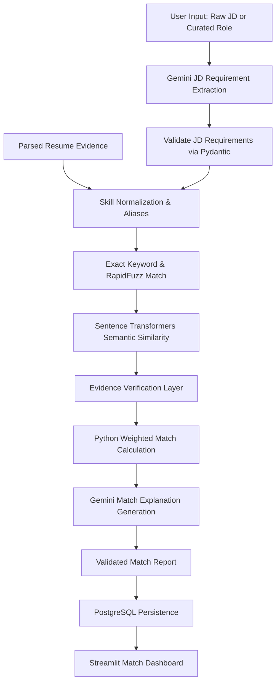

# 02. Phase 1 Workflows — Core AI Intelligence

Phase 1 establishes pure deterministic Python workflows and targeted Gemini API calls without autonomous agents.

## 1. Resume Intelligence Pipeline
```mermaid
flowchart TD
    A[Streamlit Resume Upload] --> B[FastAPI /api/v1/resumes]
    B --> C[File Validation: MIME, Magic Bytes, Size]
    C --> D[Private File Storage UUID Isolation]
    D --> E[Document Parser: PyMuPDF / python-docx]
    E --> F[Text Cleaning & Normalization]
    F --> G[Gemini Structured Extraction]
    G --> H[Pydantic Validation (ResumeSchema)]
    H --> I[Resume Evidence Normalization]
    I --> J[Deterministic Python ATS Scoring Engine]
    J --> K[Gemini Recommendation Service]
    K --> L[Report Schema Validation]
    L --> M[PostgreSQL Persistence]
    M --> N[Streamlit Analysis Report View]
```

## 2. Job Description Matching Pipeline


## Phase 1 Workflow Inventory
- **Resume Upload & Storage**: FastAPI + Private Disk Storage.
- **Document Text Extraction**: PyMuPDF (`fitz`) for PDF, `python-docx` for DOCX.
- **Structured Resume Extraction**: Gemini structured output + Pydantic schema validation.
- **ATS Readiness Scoring**: Deterministic, weighted Python mathematical model.
- **JD Extraction**: Gemini structured extraction of requirements and criteria.
- **Skill Normalization**: RapidFuzz + ontology dictionary + Sentence Transformers.
- **Recommendation Generation**: Gemini guided prompts with strict factual guardrails.
