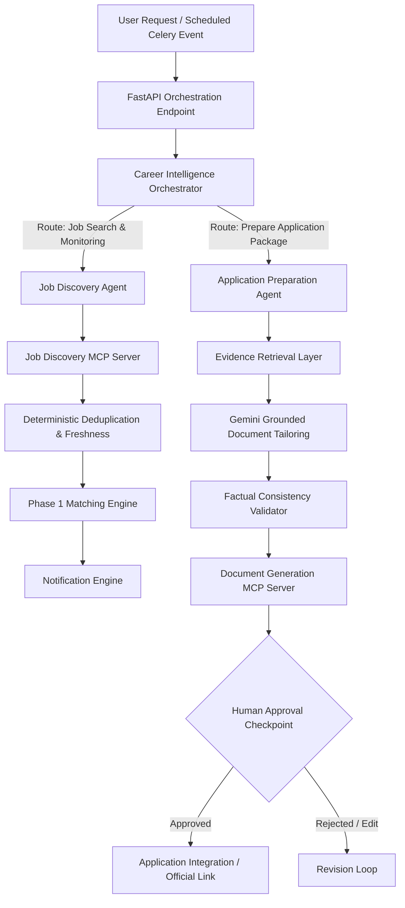

# 03. Phase 2 Multi-Agent Architecture

## The Three Specialized Agents (LangGraph)

Phase 2 introduces three specialized, bounded agents that reuse Phase 1 services without duplicating business logic:

1. **Career Intelligence Orchestrator Agent**:
   - Manages overall candidate goals and high-level intents.
   - Coordinates routing between discovery, matching, and preparation workflows.
   - Enforces human-in-the-loop checkpoints before any external action.
   - Bounded execution step limits (max 10 steps).

2. **Job Discovery Agent**:
   - Translates candidate preferences into multi-source search queries.
   - Invokes Job Discovery MCP tools (`search_jobs`, `get_job_details`).
   - Refines query filters when results are insufficient.
   - Dispatches discovered jobs to deterministic deduplication and Phase 1 matching engine.

3. **Application Preparation Agent**:
   - Selects ground-truth resume evidence matching the target JD.
   - Invokes Gemini for tailored resume content and cover letter synthesis.
   - Validates all generated statements against candidate ground truth to prevent hallucination.
   - Invokes Document Generation MCP tools to generate DOCX/PDF.
   - Pauses at explicit `AWAITING_APPROVAL` checkpoint.

## LangGraph Multi-Agent Orchestration Flow

