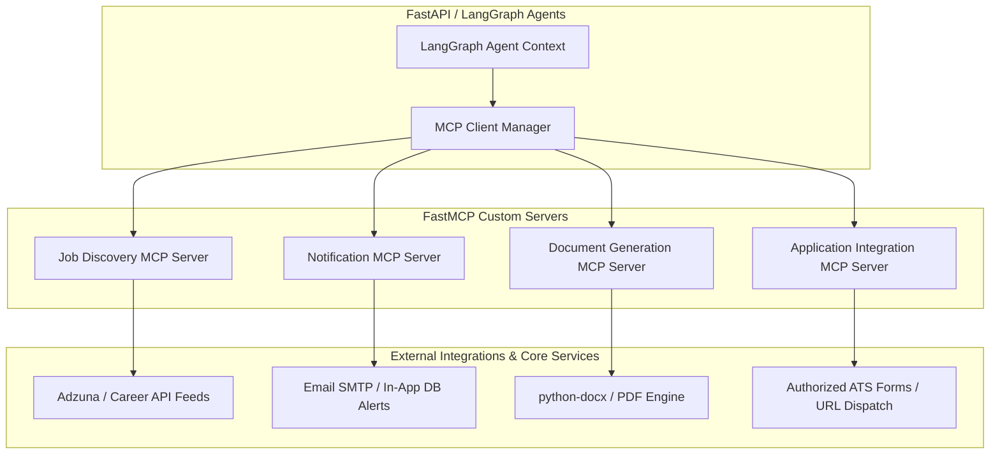

# 04. Model Context Protocol (MCP) Architecture

## Role of MCP Servers
MCP servers are stateless, typed tool providers using FastMCP / Python MCP SDK.
They **never** act as autonomous agents; they expose controlled capabilities to LangGraph agents and FastAPI services.

### Server Boundaries and Responsibilities
1. **Job Discovery Server**: Exposes `search_jobs`, `get_job_details`, `get_company_jobs`. Rate-limited, cached.
2. **Notification Server**: Exposes `send_email_notification`, `send_job_match_alert`. Enforces deduplication and user notification frequency caps.
3. **Document Generation Server**: Exposes `generate_tailored_resume`, `generate_cover_letter`, `export_resume_pdf`. Reuses python-docx templates.
4. **Application Integration Server**: Exposes `prepare_application`, `submit_application` (strictly requiring cryptographic user approval token).
