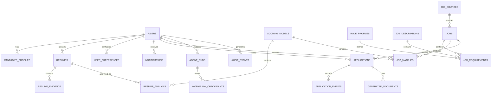

# 07. Database Design & Entity Relationship

## Database: PostgreSQL + SQLAlchemy 2.0 + Alembic

### Table Definitions & Key Constraints
- `users`: UUID primary key, email, hashed credentials, role, status.
- `resumes`: UUID pk, user_id fk, original_filename, stored_filepath, file_hash, file_size, mime_type, created_at.
- `resume_evidence`: UUID pk, resume_id fk, section, item_type, content, metadata_json.
- `resume_analysis`: UUID pk, resume_id fk, scoring_model_id, total_ats_score, breakdown_json, recommendations_json.
- `jobs`: UUID pk, source_id, external_id, title, company, location, is_remote, description, raw_hash, posting_date.
- `job_matches`: UUID pk, user_id fk, job_id fk, match_score, matched_skills_json, missing_skills_json, evidence_map_json.
- `applications`: UUID pk, user_id fk, job_id fk, status (Enum), tailored_resume_id fk, cover_letter_id fk, approved_at.
